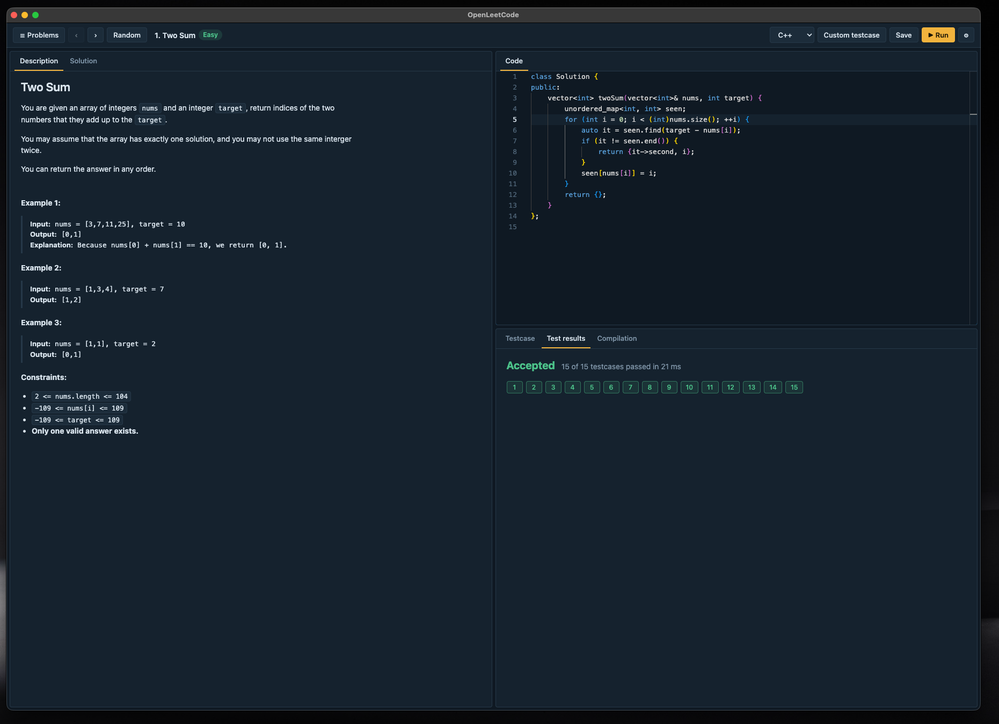

OpenLeetCode - An open source version of LeetCode
--------------------------------------------------------
Welcome to the OpenLeetCode Project!

The motivation behind this project is to be able to practice LeetCode problems on a plane without requiring an internet connection (until Starlink ramps up). This project is not intended to replace or replicate leetcode.com.

## Table of Content
- [OpenLeetCode - An open source version of LeetCode](#openleetcode---an-open-source-version-of-leetcode)
- [Table of Content](#table-of-content)
- [Screenshot](#screenshot)
- [Build](#build)
	- [Windows](#windows)
		- [Building without UI](#building-without-ui)
		- [Building with UI](#building-with-ui)
	- [Unix](#unix)
		- [Building without UI](#building-without-ui-1)
		- [Building with UI](#building-with-ui-1)
- [Run](#run)
	- [Windows](#windows-1)
		- [CLI](#cli)
		- [UI](#ui)
		- [CLI](#cli-1)
		- [UI](#ui-1)
- [How To Use](#how-to-use)
- [Problems](#problems)
- [Usage](#usage)
- [Note](#note)
- [Requirements](#requirements)
		- [Additional Requirements for the UI](#additional-requirements-for-the-ui)
- [Contributing](#contributing)


## Screenshot


## Build
### Windows
#### Building without UI
```cmd
git clone https://github.com/mbucko/openleetcode
cd openleetcode
.\install --prefix=./install
```
#### Building with UI
```cmd
git clone https://github.com/mbucko/openleetcode
cd openleetcode
.\install --prefix=./install --enable_ui
```
### Unix
#### Building without UI
```bash
git clone https://github.com/mbucko/openleetcode
cd openleetcode
./install.sh --prefix=./install
```
#### Building with UI
```bash
git clone https://github.com/mbucko/openleetcode
cd openleetcode
./install.sh --prefix=./install --enable_ui
```
## Run
### Windows
#### CLI
```cmd
dir install/OpenLeetCode
./openleetcode --language cpp --problem TwoSum
```
#### UI
```bash
dir install/OpenLeetCode
./openleetcodeui
```
### Unix
#### CLI
```bash
cd install/OpenLeetCode
./openleetcode.sh --language cpp --problem TwoSum
```
Python works the same way:
```bash
cd install/OpenLeetCode
./openleetcode.sh --language python --problem TwoSum
```
If [uv](https://docs.astral.sh/uv/) is installed, the script runs inside the project's uv environment and installs its dependencies on first use. Without uv, install the `jsonschema` package for your Python yourself.
#### UI
```bash
cd install/OpenLeetCode
./openleetcodeui.sh
```
In the UI, **☰ Problems** (or Cmd/Ctrl+P) opens the problem list, where you can search and filter by difficulty. The selector next to **▶ Run** switches between C++ and Python, and **⚙** changes the theme (dark blue, dark grey or light). Cmd/Ctrl+S saves, Cmd/Ctrl+R runs the tests and Cmd/Ctrl+T runs a custom testcase.

Test results show whether your solution was accepted and one green or red box per testcase; select a box to see that testcase's input, your output and the expected output. If your code crashes or raises an error, the result shows the line in your solution where it happened.

NOTE: The UI has been used on macOS; Linux is yet to be tested.

## How To Use
After the build succeeds, the following directory structure will be generated:

- problems
  - NumberOfIslands
    - cpp
      - solution.cpp
      - ...
    - python
      - solution.py
      - ...
    - testcases
      - TestCase1.test
      - TestCase2.test
      - ...
    - description.md
    - metadata.json
  - TwoSum
    - ..
- launguage
    - cpp
    - python

Just like for LeetCode, you have one file per language where you solve the problem: **problems/TwoSum/cpp/solution.cpp** for C++ and **problems/TwoSum/python/solution.py** for Python. Reinstalling keeps these files, so your solutions are not overwritten. To add new test cases, you can create a file in the **problems/TwoSum/testcases/** directory with the file extension **.test**, and the solution will automatically be tested against it. Test files whose name starts with `_` only run when requested by name with `--testcase`; the UI uses this for its custom testcase.

Each problem is described in the ***description.md*** file location in the problem's directory. For example ***problems/TwoSum/description.md***. The problem's LeetCode number and difficulty are in its ***metadata.json***.

The format of the .test files are as follows:

```text
<arg1>
<arg2>
<expected results>
```

The supported types are: integral type, a string, TreeNode structure, boolean or an array. For example:

```text
["1", "2", "4"]
8.0
[0, 0]
```

A ThreeNode structure is represented in an array-based structure. For example an array representation `[1, 2, null, null, 3]` results to the following structure:

      1
     / \
    2   3

## Problems
OpenLeetCode ships with over a hundred problems, including variations of LeetCode problems #1 through #100. Every problem has both a C++ and a Python version.

To see the full list, run:
```bash
cd install/OpenLeetCode
./openleetcode.sh --list-problems
```

The problem names are automatically extracted from the **problems** folder.

## Usage
```text
$ ./openleetcode.sh --help
usage: openleetcode.py [-h] [--language {cpp,python}] [--list-problems]
                       [--list-testcases] [--problem problem_name]
                       [--problem_builds_dir dir] [--run-expected-tests]
                       [--testcase testcase_name] [--verbose]

OpenLeetCode problem builder. This script builds and tests a LeetCode-like
problems locally. Currently, it supports the C++ and Python languages, but it
can be extended to support other languages.

options:
  -h, --help            show this help message and exit
  --language {cpp,python}, -l {cpp,python}
                        The programming language.
  --list-problems       List problems.
  --list-testcases      List testcases for a problem specified with '--
                        problem' option.
  --problem problem_name, -p problem_name
                        Name of the problem to build and test. Default:
                        TwoSum. Use --list-problems to list all problems.
  --problem_builds_dir dir, -d dir
                        Specifies the directory with the problems. Typically,
                        this is './problem_builds'. If not provided, the
                        script defaults to './problem_builds' in the same
                        directory as the executable.
  --run-expected-tests, -r
                        Run the expected solution. Default: False.
  --testcase testcase_name, -t testcase_name
                        Name of the testcase to run. '--testcase All' will run
                        all testcases. Default: All.
  --verbose, -v         Print verbose output
```

## Note
Both the CLI and the UI support C++ and Python.

## Requirements
This project requires the following to run:

- Python
- CMake 3.12
- Git
- [uv](https://docs.astral.sh/uv/) (recommended), or the `jsonschema` Python package

#### Additional Requirements for the UI
- npm

## Contributing
Feel free to contribute with code, test cases, or even code reviews.

For a more in-depth guide on how to contribute and information about the inner workings of OpenLeetCode, please refer to the [Docs](docs/index.md).
You can also join our [Discord chat](https://discord.gg/BzkqubYUm8) if you have any questions about the usage or development.
